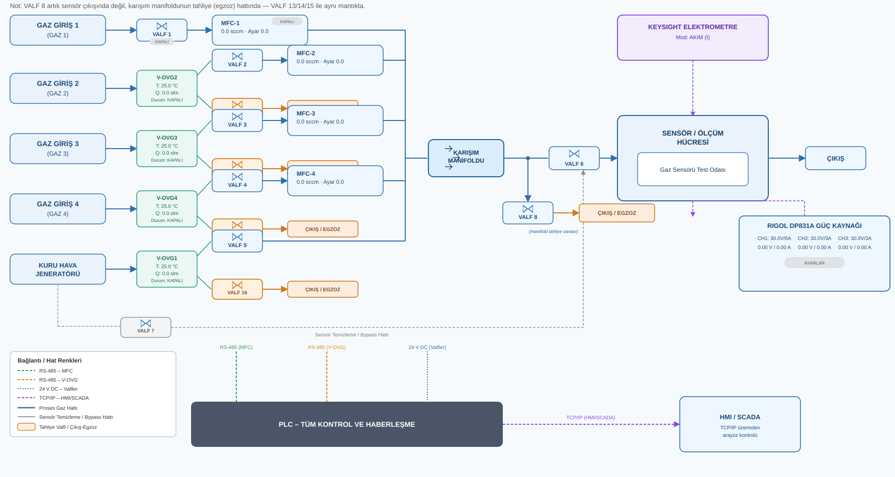

<div align="center">

# 🌬️ Hava Kontrol
### Endüstriyel Gaz Akış & Buharlaşma SCADA Test Otomasyon Platformu
#### *Industrial Gas Flow & Vapor Control SCADA Automation Platform*

[](https://dotnet.microsoft.com/)
[](https://docs.microsoft.com/en-us/dotnet/csharp/)
[](https://www.deltaww.com/)
[](https://modbus.org/)
[](https://github.com/shimat/opencvsharp)
[](#-yazılım-mimarisi-ve-scada-arayüzü)
[-0078D6?style=for-the-badge&logo=windows&logoColor=white)](#-kurulum-ve-çalıştırma)
[](#-lisans-ve-geliştirici)

<br>

**Nanoteknolojik gaz sensörlerinin (grafen, metal-oksit nano-teller, karbon nanotüpler) dinamik test odalarında karakterizasyonu için geliştirilmiş;**<br>
**4 Bağımsız Gaz Hattı, 4 Kütle Akış Kontrolörü (MFC), 4 Buharlaştırıcı Fırın (V-OVG), 12 Pnömatik Valf,**<br>
**Keysight SMU, Rigol DC Güç Kaynağı ve Keithley Elektrometre entegrasyonlu uçtan uca modern SCADA sistemi.**

<br>

[📌 Genel Bakış](#-sistem-genel-bakışı) •
[🗺️ P&ID Şeması](#️-proses-ve-enstrümantasyon-şeması-pid) •
[🔌 Donanım Ekosistemi](#-donanım-ve-enstrümantasyon-ekosistemi) •
[💻 SCADA Özellikleri](#-yazılım-mimarisi-ve-scada-arayüzü) •
[🧪 Reçete Motoru](#-otomatik-test-reçete-motoru-recipeengine) •
[📈 Trend Analizi](#-yüksek-hızlı-canlı-trend-ve-veri-analizi) •
[🚀 Hızlı Başlangıç](#-kurulum-ve-çalıştırma)

</div>

---

## 📋 İçindekiler
- [🌟 Sistem Genel Bakışı](#-sistem-genel-bakışı)
  - [Temel Amaç ve Çözülen Problemler](#temel-amaç-ve-çözülen-problemler)
  - [Temel Kabiliyetler](#temel-kabiliyetler)
- [🗺️ Proses ve Enstrümantasyon Şeması (P&ID)](#️-proses-ve-enstrümantasyon-şeması-pid)
  - [Gaz Akış Hatları Mimarisi](#gaz-akış-hatları-mimarisi)
- [🔌 Donanım ve Enstrümantasyon Ekosistemi](#-donanım-ve-enstrümantasyon-ekosistemi)
  - [1. Delta AS228P-A PLC & Genişleme Modülü](#1-delta-as228p-a-plc--genişleme-modülü)
  - [2. Kütle Akış Kontrolörleri (MFC 1–4)](#2-kütle-akış-kontrolörleri-mfc-14)
  - [3. V-OVG (Vapor Oven Generator) Buhar Hücreleri](#3-v-ovg-vapor-oven-generator-buhar-hücreleri)
  - [4. Hassas Metroloji & Ölçüm Enstrümanları](#4-hassas-metroloji--ölçüm-enstrümanları)
  - [5. OpenCV Endüstriyel Kamera Sistemi](#5-opencv-endüstriyel-kamera-sistemi)
- [📊 Sistem Haberleşme ve Ağ Topolojisi](#-sistem-haberleşme-ve-ağ-topolojisi)
  - [PLC Modbus Register Haritası (D & Y Alanları)](#plc-modbus-register-haritası-d--y-alanları)
- [💻 Yazılım Mimarisi ve SCADA Arayüzü](#-yazılım-mimarisi-ve-scada-arayüzü)
  - [Arayüz Tasarım Prensipleri](#arayüz-tasarım-prensipleri)
  - [Süreç Değerleri Hesaplama Motoru](#süreç-değerleri-hesaplama-motoru)
- [🧪 Otomatik Test Reçete Motoru (RecipeEngine)](#-otomatik-test-reçete-motoru-recipeengine)
  - [Reçete Yapısı ve Örnek JSON](#reçete-yapısı-ve-örnek-json)
  - [Çalışma Modları](#çalışma-modları)
- [📈 Yüksek Hızlı Canlı Trend ve Veri Analizi](#-yüksek-hızlı-canlı-trend-ve-veri-analizi)
- [🛡️ Güvenlik, İnterloklar ve Fail-Safe Mimarisi](#️-güvenlik-i̇nterloklar-ve-fail-safe-mimarisi)
- [📁 Proje Dizin Yapısı](#-proje-dizin-yapısı)
- [🚀 Kurulum ve Çalıştırma](#-kurulum-ve-çalıştırma)
  - [Sistem Gereksinimleri](#sistem-gereksinimleri)
  - [1. Standalone Tek Dosya EXE Paketi (Tavsiye Edilen)](#1-standalone-tek-dosya-exe-paketi-tavsiye-edilen)
  - [2. Kaynak Koddan Derleme (Geliştirici Modu)](#2-kaynak-koddan-derleme-geliştirici-modu)
  - [Donanım & Port Yapılandırması](#donanım--port-yapılandırması)
- [⌨️ Operatör Kısayolları](#️-operatör-kısayolları)
- [👥 Lisans ve Geliştirici](#-lisans-ve-geliştirici)

---

## 🌟 Sistem Genel Bakışı

**Hava Kontrol SCADA Platformu**, ileri malzeme bilimi ve nanoteknoloji laboratuvarlarında gaz sensörlerinin (grafen tabanlı transistörler, metal-oksit nano-teller, karbon nanotüpler vb.) kontrollü gaz ve kimyasal buhar ortamlarındaki tepkilerini, hassasiyetlerini ve empedans değişimlerini mikrosaniye hassasiyetinde ölçmek amacıyla geliştirilmiş **endüstriyel düzeyde bir SCADA & Test Otomasyon Sistemidir**.

### Temel Amaç ve Çözülen Problemler
Geleneksel laboratuvar düzeneklerinde yaşanan:
* Manuel vana açma/kapama gecikmeleri ve operatör hataları,
* Dinamik gaz seyreltme (blending) oranlarının anlık hesaplanamaması,
* Buharlaşma fırınları (V-OVG), kütle akış kontrolörleri (MFC) ve elektriksel ölçüm cihazlarının (SMU/Elektrometre) birbirinden kopuk yazılımlarla yönetilmesi,
* Uzun süren (saatler/günler) test döngülerinde insan gözetimi gereksinimi

sorunları, **Hava Kontrol** sistemi ile tek bir merkezi, güvenli ve otomatik SCADA çatısı altında çözülmüştür.

### Temel Kabiliyetler
* **Dinamik Gaz Karışımı (Dynamic Gas Blending):** 4 farklı gaz/buhar hattını kütle akış kontrolörleri (MFC) ile sccm seviyesinde hassas karıştırarak ppm/ppb düzeyinde hedef analit konsantrasyonu oluşturma.
* **Kimyasal Buharlaşma Kontrolü (Vapor Generation):** 4 bağımsız V-OVG fırın hücresinin sıcaklık (25–100 °C) ve taşıyıcı gaz debisini Eurotherm 3200 PID kontrolcüler üzerinden eş zamanlı denetleme.
* **Picoamper Seviyesinde Hassas Metroloji:** Keysight B2902B SMU ve Keithley 6517B elektrometre üzerinden pA/fA mertebesinde sensör elektriksel tepkisi, akım-voltaj (I-V) ve direnç-zaman (R-t) karakterizasyonu.
* **Asenkron & Sıfır Donma Mimarisi:** Çok iş parçacıklı (multi-threaded) non-blocking mimari sayesinde 100 ms periyotlu PLC ve seri port haberleşmesi kesintisiz çalışırken SCADA arayüzü 60 FPS akıcılıkta kalır.
* **Tam Otomatik Reçete Motoru (RecipeEngine):** Gaz besleme, süpürme (purge), bekleme ve I-V elektriksel ölçüm adımlarını içeren test sekanslarını operatörsüz çalıştıran JSON tabanlı gelişmiş motor.
* **Fail-Safe Endüstriyel Emniyet:** Otomatik gaz tahliyesi, manifold egzoz bypassı, fırın sıcaklık interlokları ve tek dokunuşla tüm sistemi güvenli duruma getiren **🚨 ACİL DURDUR** koruma kalkanı.

---

## 🗺️ Proses ve Enstrümantasyon Şeması (P&ID)

Sistem; 4 ana proses hattı, 1 kuru hava temizleme hattı, homojen karışım manifoldu, sensör test hücresi ve egzoz tahliye kollarından oluşmaktadır:

<div align="center">
  
  <p><i>Şekil 1: Hava Kontrol Proses Akış ve Enstrümantasyon (P&ID) Şeması</i></p>
</div>

### Gaz Akış Hatları Mimarisi

| Hat | Tanım | Akış Yolu | Debimetre (MFC) | Tahliye Valfi |
|:---|:---|:---|:---:|:---:|
| **Hat 1** | **Taşıyıcı / Seyreltici Gaz** | Gaz Giriş 1 ➔ Valf 1 ➔ MFC-1 ➔ Karışım Manifoldu | 0–1000 sccm | - |
| **Hat 2** | **Kimyasal Buhar / Analit 1** | Gaz Giriş 2 ➔ V-OVG 2 Fırını ➔ Valf 2 ➔ MFC-2 ➔ Karışım Manifoldu | 0–250 sccm | Valf 13 (Egzoz) |
| **Hat 3** | **Kimyasal Buhar / Analit 2** | Gaz Giriş 3 ➔ V-OVG 3 Fırını ➔ Valf 3 ➔ MFC-3 ➔ Karışım Manifoldu | 0–250 sccm | Valf 14 (Egzoz) |
| **Hat 4** | **Kimyasal Buhar / Analit 3** | Gaz Giriş 4 ➔ V-OVG 4 Fırını ➔ Valf 4 ➔ MFC-4 ➔ Karışım Manifoldu | 0–250 sccm | Valf 15 (Egzoz) |
| **Hat 5** | **Kuru Hava Temizleme Hattı** | Kuru Hava Girişi ➔ V-OVG 1 Hücresi ➔ Valf 5 ➔ Karışım Manifoldu | Sistem Debisi | Valf 16 (Egzoz) |
| **Bypass** | **Sensör Hızlı Nötrleme** | Kuru havayı manifolda uğratmadan doğrudan test hücresine yönlendirir (Valf 7) | - | - |
| **Manifold** | **Hücre Besleme & Tahliye** | Homojen karışımı sensör odasına yönlendirir (Valf 6) veya egzoza atar (Valf 8) | - | Valf 8 (Manifold Egzoz) |

---

## 🔌 Donanım ve Enstrümantasyon Ekosistemi

```text
┌───────────────────────────────────────────────────────────────────────────────────────────────────┐
│                                   HAVA KONTROL DONANIM ENVANTERİ                                  │
├───────────────────────────────────────────────────────────────────────────────────────────────────┤
│  1. ANA KONTROLÖR : Delta AS228P-A PLC + AS08AN01P-A Genişleme (Modbus TCP - 192.168.1.5:502)     │
│  2. AKIŞ KONTROL  : 4x Mass Flow Controller (MFC 1..4, COM2 RS-485 Modbus RTU 9600 8-E-1)          │
│  3. BUHAR FIRINI  : 4x V-OVG Generator (Eurotherm 3200 Sıcaklık & Debi, USB-RS485 COM12 9600)    │
│  4. PNÖMATİK VALF : 12x Endüstriyel Solenoid Valf (24V DC Opto-İzole) + 4x Güç Rölesi            │
│  5. SMU ÖLÇÜM     : Keysight B2902B Çift Kanal Precision Source/Measure Unit (SCPI / USB-VISA)   │
│  6. DC GÜÇ        : Rigol DP831 / DP831A 3 Kanallı Programlanabilir Güç Kaynağı (SCPI / USB-VISA)│
│  7. ELEKTROMETRE  : Keithley 6517B Yüksek Direnç / pA Elektrometre Entegrasyonu (RS-232 / SCPI)  │
│  8. GÖRÜNTÜLEME   : OpenCvSharp4 Endüstriyel UVC / DirectShow Canlı Video & Snapshot Motoru       │
└───────────────────────────────────────────────────────────────────────────────────────────────────┘
```

### 1. Delta AS228P-A PLC & Genişleme Modülü
* **Ethernet Bağlantısı:** Standart Modbus TCP protokolü ile PC SCADA iş istasyonuna `192.168.1.5:502` üzerinden tam çift yönlü bağlantı.
* **Dahili Çıkışlar (Y0.0 – Y0.15):**
  * `Y0.0 – Y0.7`: Valf 1 – Valf 8 Proses Valfleri.
  * `Y0.8 – Y0.11`: Güç Çıkışları 1 – 4 (Isıtıcı / Yardımcı Röle Sürüşü).
  * `Y0.12 – Y0.15`: Emniyet & Yedek Hatlar (`M50..M53` Fırın güvenlik kilitleri).
* **AS08AN01P-A Genişleme Modülü (Slot 1: Y1.0 – Y1.7):**
  * `Y1.0 – Y1.3`: Valf 13 – Valf 16 (V-OVG Egzoz / Tahliye Valfleri).
  * `Y1.4 – Y1.7`: Rezerv röle çıkışları.
* **PLC Ladder Mimarisi:**
  * `M1002` İlk tarama (First-Scan) bloğu ile açılışta güvenli başlangıç parametreleri (`D455=1`, `D300=1`).
  * 16 adımlı döngüsel kilitlenmeyen MFC polling durum makinesi (`MODRW` yönergeleri).
  * Ağ veya yazılım kopmasında otomatik acil durum valf kapatma koruması.

### 2. Kütle Akış Kontrolörleri (MFC 1–4)
* **Haberleşme:** RS-485 Modbus RTU (PLC COM2 portu, 9600 Baud, 8 Data bit, Even Parity, 1 Stop bit).
* **Adresleme:** Slave ID 1 (MFC-1), Slave ID 2 (MFC-2), Slave ID 3 (MFC-3), Slave ID 4 (MFC-4).
* **Ölçüm & Set:** 32-bit kayan noktalı (IEEE-754 Float) setpoint yazma, anlık akış geribildirimi (PV), çalışma durumu ve tolerans bandı denetimi.

### 3. V-OVG (Vapor Oven Generator) Buhar Hücreleri
* **Kontrolör Tipi:** Eurotherm 3200 Serisi Dijital PID Sıcaklık ve Proses Kontrolörleri.
* **Haberleşme:** PC doğrudan bağlantılı USB-RS485 dönüştürücü (`COM12`, 9600 Baud, 8-E-1).
* **Kanal Yapısı:**
  * **Sıcaklık Kontrolörü (RRXX):** RS485 Slave 3, 25.0 – 100.0 °C aralığı (0.1 °C çözünürlük, 10x ölçekleme).
  * **Taşıyıcı Gaz Akışı (RCXX):** RS485 Slave 4, 0 – 250 sccm taşıyıcı akış denetimi.
* **Donanımsal Koruma:** Maksimum sıcaklık eşiği aşımında çıkış gücünü otomatik sıfırlama (%OP = 0).

### 4. Hassas Metroloji & Ölçüm Enstrümanları
* **Keysight B2902B Precision SMU:**
  * SCPI komut seti üzerinden USB-TMC / VISA oturumu.
  * fA – pA düzeyinde akım ölçümü, ±210 V gerilim aralığı, çift kanal bağımsız kaynak/ölçüm modu.
  * Eş zamanlı direnç ($R = V/I$) türetimi ve canlı grafik beslemesi.
* **Rigol DP831 Programlanabilir DC Güç Kaynağı:**
  * 3 Bağımsız Kanal: CH1 (8V/5A), CH2 (+30V/2A), CH3 (-30V/2A).
  * OVP (Aşırı Gerilim) ve OCP (Aşırı Akım) donanımsal koruma kilitleri.
* **Keithley 6517B Elektrometre Desteği:**
  * Yüksek giriş empedansı (>200 TΩ) ile aşırı hassas yüzey iletkenliği ve kaçak akım testleri.

### 5. OpenCV Endüstriyel Kamera Sistemi
* **Görüntü İşleme Motoru:** `OpenCvSharp4` + Windows DirectShow / WMI cihaz algılama altyapısı.
* **Kullanım Amacı:** V-OVG fırın tüplerindeki buharlaşma dinamiğini, kılcal tüp sıvı seviyelerini ve sensör test odasını gerçek zamanlı izleme.
* **Yedekli Çalışma:** Fiziksel kamera bulunmadığında simülasyon modu devreye girer; tek tıkla yüksek çözünürlüklü snapshot alma (`Captures/V-OVG/`).

---

## 📊 Sistem Haberleşme ve Ağ Topolojisi

```mermaid
graph TD
    subgraph PC["SCADA İŞ İSTASYONU (C# .NET 8 WPF)"]
        UI["Modern Dashboard (1920x1080)"]
        VM["MainViewModel & Modüler ViewModels"]
        RECIPE["RecipeEngine (Otomasyon & Reçete)"]
        LOG["LoggingService (CSV & RAM Buffer)"]
        TREND["TrendGraph Engine (LTTB Downsampling)"]
        CAM["CameraService (OpenCvSharp4)"]
        
        UI <--> VM
        VM --> RECIPE
        VM --> LOG
        VM --> TREND
        VM --> CAM
    end

    subgraph PROTOCOLS["HABERLEŞME KATMANI"]
        TCP["Modbus TCP (192.168.1.5:502)"]
        COM_MFC["PLC COM2 RS-485 (9600 8-E-1)"]
        COM_VOVG["PC USB-RS485 COM12 (9600 8-E-1)"]
        VISA["USB-TMC / SCPI Protocol (VISA Session)"]
        UVC["DirectShow / UVC Video Stream"]
    end

    subgraph PLC_SYS["DELTA AS228P-A PLC SİSTEMİ"]
        CPU["AS228P-A CPU"]
        EXT["AS08AN01P-A Genişleme Modülü"]
        VALVES["Valf 1 - 8 (Y0.0 - Y0.7)"]
        POWER_RELAYS["Güç Röleleri 1 - 4 (Y0.8 - Y0.11)"]
        EXHAUST_VALVES["Tahliye Valfleri 13 - 16 (Y1.0 - Y1.3)"]
        
        CPU --> VALVES
        CPU --> POWER_RELAYS
        EXT --> EXHAUST_VALVES
    end

    subgraph MFC_DEVICES["KÜTLE AKIŞ KONTROLÖRLERİ"]
        MFC1["MFC-1 (Taşıyıcı Gaz)"]
        MFC2["MFC-2 (Analit 1)"]
        MFC3["MFC-3 (Analit 2)"]
        MFC4["MFC-4 (Analit 3)"]
    end

    subgraph VOVG_DEVICES["V-OVG BUHAR JENERATÖRLERİ"]
        VOVG1["V-OVG 1 (Kuru Hava)"]
        VOVG2["V-OVG 2 (Kimyasal 1)"]
        VOVG3["V-OVG 3 (Kimyasal 2)"]
        VOVG4["V-OVG 4 (Kimyasal 3)"]
    end

    subgraph METROLOGY["METROLOJİ VE ENSTRÜMANTASYON"]
        KEYSIGHT["Keysight B2902B SMU (pA / V / R)"]
        RIGOL["Rigol DP831 (3 Kanallı DC Kaynak)"]
        KEITHLEY["Keithley 6517B Elektrometre"]
        CAM_HW["Fırın / Hücre Gözlem Kameraları"]
    end

    VM -->|"PlcService"| TCP
    TCP --> CPU
    CPU --> COM_MFC
    COM_MFC --> MFC1 & MFC2 & MFC3 & MFC4

    VM -->|"EurothermService"| COM_VOVG
    COM_VOVG --> VOVG1 & VOVG2 & VOVG3 & VOVG4

    VM -->|"Keysight / Rigol Services"| VISA
    VISA --> KEYSIGHT & RIGOL & KEITHLEY

    CAM --> UVC
    UVC --> CAM_HW
```



### PLC Modbus Register Haritası (D & Y Alanları)

| Parametre / Fonksiyon | PLC Yazma Adresi | PLC Okuma / Durum Adresi | Veri Tipi | Açıklama |
|:---|:---:|:---:|:---:|:---|
| **Valf 1 – 8 (Pnömatik Hat)** | `D100 – D107` | `D200 – D207` | 16-bit INT | 1: Aç, 0: Kapat (`Y0.0 – Y0.7`) |
| **Güç Çıkışı 1 – 4 (Röleler)** | `D108 – D111` | `D208 – D211` | 16-bit INT | 1: Enerjili, 0: Kesik (`Y0.8 – Y0.11`) |
| **Valf 13 – 16 (V-OVG Tahliye)** | `D112 – D115` | `D212 – D215` | 16-bit INT | 1: Aç, 0: Kapat (`Y1.0 – Y1.3`) |
| **MFC-1 Setpoint / Akış** | `D312` | `D412` | 32-bit Float | Taşıyıcı Gaz Akışı (0–1000 sccm) |
| **MFC-2 Setpoint / Akış** | `D322` | `D422` | 32-bit Float | Gaz / Buhar 2 Akışı (0–250 sccm) |
| **MFC-3 Setpoint / Akış** | `D332` | `D432` | 32-bit Float | Gaz / Buhar 3 Akışı (0–250 sccm) |
| **MFC-4 Setpoint / Akış** | `D342` | `D442` | 32-bit Float | Gaz / Buhar 4 Akışı (0–250 sccm) |
| **MFC State Machine Adımı** | - | `D455` | 16-bit INT | PLC dahili polling adımı (`1..16`) |
| **Fırın Emniyet İnterlokları** | `M50 – M53` | - | Bit (Coil) | Isıtma çalışma izni kontakları |
| **Watchdog Sayacı** | `D450` | `D450` | 16-bit INT | SCADA yaşam sinyali (Heartbeat) |

---

## 💻 Yazılım Mimarisi ve SCADA Arayüzü

SCADA arayüzü, uzun süreli laboratuvar testlerinde operatör göz yorgunluğunu en aza indiren modern, yüksek kontrastlı endüstriyel koyu-açık hibrit renk paletiyle tasarlanmıştır.

### Arayüz Tasarım Prensipleri
* **1920x1080 No-Scroll Düzeni:** Operatörün kritik süreç parametrelerine ve emniyet kilitlerine kaydırma çubuğu olmadan tek ekrandan hakim olmasını sağlayan ergonomik panel mimarisi.
* **Etkileşimli P&ID Süreç Paneli:**
  * Boru hatları üzerinde gerçek zamanlı akış yönü animasyonları.
  * Valf simgelerine tek tıkla doğrudan açma/kapama müdahalesi.
  * Tıklanan herhangi bir cihazın (MFC, V-OVG, Valf, SMU vb.) sağ taraftaki dinamik denetleyici kartında anında açılması (`ISelectableDevice`).
* **Konsolide Cihaz Sağlığı Özeti (Badge Flyout):** Üst durum çubuğundaki rozet üzerinden PLC, MFC'ler, V-OVG'ler, SMU ve Güç Kaynağının bağlantı durumlarını açılır flyout pencerede tek bakışta izleme.
* **Hızlı Müdahale Denetleyicisi:** Seçilen her cihaza özel hassas slider, sayısal giriş kutusu, donanım limit korumaları ve grafiksel sapma göstergesi.

### Süreç Değerleri Hesaplama Motoru
Sistem arka planda her 200 ms'de bir gaz karışımının dinamik metriklerini otomatik hesaplar:

$$\text{Toplam Debi } (Q_{\text{total}}) = \sum_{i=1}^{4} Q_{\text{MFC}\_i} + Q_{\text{KuruHava}}$$

$$\text{Hedef Konsantrasyon (ppm)} = C_{\text{kaynak}} \times \frac{Q_{\text{analit}}}{Q_{\text{total}}}$$

$$\text{Seyreltme Oranı (Dilution Ratio)} = \frac{Q_{\text{total}}}{Q_{\text{analit}}}$$

* **Kararlılık Algılayıcı (Stability Detector):** MFC debileri ve fırın sıcaklıkları belirlenen tolerans bandında ($\pm\%1.5$) kaldığında kararlılık sayacı tetiklenir ve reçete motoruna ölçüm için "Sistem Kararlı" sinyali üretir.

---

## 🧪 Otomatik Test Reçete Motoru (RecipeEngine)

Karmaşık ve uzun süreli sensör testlerini operatörsüz otomatikleştiren **RecipeEngine**, esnek bir betik mimarisine sahiptir.

### Reçete Yapısı ve Örnek JSON

```json
{
  "RecipeName": "Aseton_Dinamik_Tepki_Testi",
  "Author": "Laboratuvar_Ekibi",
  "LoopCount": 5,
  "ExecutionMode": "Sequential",
  "Steps": [
    {
      "StepIndex": 1,
      "DeviceType": "Valve",
      "DeviceId": 1,
      "TargetState": "Open",
      "DurationSeconds": 300,
      "Description": "Sensör hücresini 5 dakika taşıyıcı gaz ile süpür (Purge)"
    },
    {
      "StepIndex": 2,
      "DeviceType": "Mfc",
      "DeviceId": 2,
      "Setpoint": 50.0,
      "DurationSeconds": 180,
      "Description": "50 sccm Aseton buharı besle (Exposure)"
    },
    {
      "StepIndex": 3,
      "DeviceType": "Electrometer",
      "Action": "Measure_IV_Sweep",
      "DurationSeconds": 60,
      "Description": "Keysight SMU ile I-V eğrisi kaydet"
    }
  ]
}
```

### Çalışma Modları
1. **Sıralı Mod (Sequential):** Her adım tanımlanan süre boyunca çalışır, tamamlandığında bir sonraki adıma geçer.
2. **Kuyruk Modu (PerDeviceQueue - Asenkron):** Farklı cihazlar (örneğin fırın sıcaklık ön ısıtması ve taşıyıcı gaz stabilizasyonu) bağımsız zamanlayıcılarla paralel yürütülür.
3. **Anlık Kontrol:** Çalışma esnasında *Duraklat (Pause)*, *Devam Et (Resume)* veya *Güvenli İptal (Abort)* özellikleri.

---

## 📈 Yüksek Hızlı Canlı Trend ve Veri Analizi

`TrendGraphView`, sensör karakterizasyonu için özel olarak optimize edilmiş yüksek performanslı bir çizim motorudur:

* **8–12 Saat Kesintisiz Kayıt:** RAM tamponunda 43.200 veri noktası saklanabilir. Bellek taşmasını ve arayüz donmasını engellemek için **LTTB (Largest-Triangle-Three-Buckets) / Min-Max Alt Örnekleme** algoritmaları kullanılır.
* **3 Bağımsız Trend Modu:**
  1. **MFC Modu:** 4 Kütle Akış Kontrolörünün gerçek akış (PV) ve hedef (SP) değerleri.
  2. **Keysight SMU Modu:** Canlı akım (pA/nA/µA), gerilim (V) ve empedans ($R$).
  3. **V-OVG Modu:** Fırın sıcaklıkları (°C) ve taşıyıcı debileri (sccm).
* **Kullanıcı Etkileşimi:**
  * Fare tekerleği ile dinamik yakınlaştırma (*Zoom In/Out*).
  * Sağ tıkla sürükleyerek zamanda geriye doğru gezinme (*Pan*).
  * **HUD Crosshair:** İmlecin bulunduğu noktadaki milisaniyelik zamanı ve tüm kanalların anlık değerlerini gösteren hassas kılavuz çizgisi.
* **Veri Dışa Aktarımı:**
  * **Excel / MATLAB Uyumlu CSV:** Zaman damgalı ham ölçüm verisi dışa aktarma.
  * **Yüksek Çözünürlüklü Görsel (PNG):** Raporlama ve akademik yayınlar için anlık grafik kaydı.

---

## 🛡️ Güvenlik, İnterloklar ve Fail-Safe Mimarisi

Sistem; yanıcı, toksik veya pahalı analitlerin kullanıldığı ortamlarda azami can ve cihaz güvenliği sağlayacak şekilde tasarlanmıştır:

```text
[GÜVENLİK ALARMI VEYA ACİL DURDUR TETİKLENDİĞİNDE]
  │
  ├── 1. TÜM PNÖMATİK PROSES VALFLERİ DERHAL KAPATILIR (Valf 1..6 = 0)
  ├── 2. TÜM MFC AKIŞ SETPOINT'LERİ SIFIRLANIR (SP1..4 = 0.0 sccm)
  ├── 3. V-OVG ISITICI VE FIRIN GÜÇLERİ KESİLİR (OP = 0%, M50..M53 = 0)
  ├── 4. YÜKSEK GERİLİM VE DC GÜÇ ÇIKIŞLARI KESİLİR (Keysight & Rigol Output = OFF)
  ├── 5. EGZOZ VE TAHLİYE VALFLERİ AÇILIR (Valf 8, 13, 14, 15, 16 = AÇIK)
  └── 6. OTOMATİK AZOT / KURU HAVA SÜPÜRMESİ (PURGE) DEVREYE ALINIR
```

* **Donanımsal & Yazılımsal Watchdog:** PC ile PLC arasındaki Modbus TCP haberleşmesi 2 saniyeden uzun süre kesilirse, PLC kendi ladder programı üzerinden otomatik güvenlik moduna geçer.
* **Fırın Termal Koruması:** Fırın hücresi 110 °C üzerine çıktığında yazılım donanım iznini (`M50..M53`) anında keser.

---

## 📁 Proje Dizin Yapısı

```text
HavaKontrol/
├── Dagitim_Paketi/               # Taşınabilir bağımsız EXE dağıtım paketi
│   ├── BeniOku_Kurulum.txt       # Hedef bilgisayar kurulum yönergeleri
│   ├── Masaustu_Kisayolu_Olustur.bat
│   └── hava_kontrol.exe          # (.NET 8 Self-Contained Standalone EXE)
├── hava_kontrol/                 # C# .NET 8 WPF SCADA Kaynak Kodları
│   ├── hava_kontrol.sln          # Visual Studio Çözüm Dosyası
│   └── hava_kontrol/
│       ├── Converters/           # XAML Değer Dönüştürücüleri (Bool, Renk, Durum)
│       ├── Models/               # Donanım Konfigürasyon ve Veri Modelleri
│       │   ├── EurothermConfig.cs       # Eurotherm 3200 Register & Modbus Modelleri
│       │   ├── PlcConfig.cs             # Delta AS228P I/O ve Register Haritası
│       │   ├── RecipeModel.cs           # Test Reçete ve Adım Modelleri
│       │   ├── KeysightB2902bConfig.cs  # SMU Konfigürasyonu
│       │   ├── RigolDp831Config.cs      # DC Güç Kaynağı Konfigürasyonu
│       │   └── CameraConfig.cs          # DirectShow / WMI Kamera Ayarları
│       ├── Services/             # Donanım Sürücüleri ve Arka Plan Servisleri
│       │   ├── PlcService.cs            # Modbus TCP Asenkron PLC İletişimi
│       │   ├── MfcManager.cs            # 4x MFC Koordinatörü
│       │   ├── EurothermService.cs      # Modbus RTU Seri Port Servisi
│       │   ├── VovgManager.cs           # 4x Buhar Fırını Yöneticisi
│       │   ├── KeysightB2902bService.cs # SCPI / VISA SMU Sürücüsü
│       │   ├── RigolDp831Service.cs     # SCPI / VISA DC Kaynak Sürücüsü
│       │   ├── RecipeEngine.cs          # Asenkron Reçete Yürütme Motoru
│       │   ├── CameraService.cs         # OpenCvSharp4 Görüntü İşleme Servisi
│       │   └── LoggingService.cs        # Olay Günlüğü ve CSV Arşivleme
│       ├── ViewModels/           # MVVM Sunum Mantığı
│       │   ├── MainViewModel.cs         # Ana SCADA Orkestratörü
│       │   ├── MfcViewModel.cs          # MFC Kart Mantığı
│       │   ├── VovgViewModel.cs         # V-OVG Kart Mantığı
│       │   ├── ValveViewModel.cs        # Solenoid Valf Mantığı
│       │   ├── ElectrometerViewModel.cs # SMU & Ölçüm Mantığı
│       │   └── PowerSupplyViewModel.cs  # DC Kaynak Mantığı
│       ├── Views/                # XAML Kullanıcı Arayüzü Panelleri
│       │   ├── MainWindow.xaml          # Ana SCADA Kabuğu (1920x1080)
│       │   ├── ProcessFlowDiagramView   # İnteraktif P&ID Şeması
│       │   ├── TrendGraphView           # Çok Eksenli Canlı Trend Grafiği
│       │   ├── DeviceDetailView         # Dinamik Cihaz Denetleyici Paneli
│       │   ├── RecipeDialogView         # Reçete Editörü ve Yürütme Penceresi
│       │   ├── VovgCameraWindow         # Canlı Kamera Gözlem Penceresi
│       │   └── EventLogView             # Gerçek Zamanlı Alarm & Olay Günlüğü
│       └── hava_kontrol.csproj   # Proje Yapılandırması ve Bağımlılıklar
├── sistem_semasi_duzeltilmis.svg # Vektörel Sistem Akış ve P&ID Şeması
├── plc_ladder_final.md           # Delta AS228P PLC Ladder Kodları ve Açıklamaları
├── implementation_plan.md        # V-OVG & Metroloji Entegrasyon Mimarisi
├── EXE_OLUSTUR.bat               # Otomatik Tek Dosya EXE Derleme Betiği
└── README.md                     # Proje Dokümantasyonu (Bu Dosya)
```

---

## 🚀 Kurulum ve Çalıştırma

### Sistem Gereksinimleri
* **İşletim Sistemi:** Windows 10 veya Windows 11 (64-bit x64).
* **Donanım Bağlantıları:**
  * Ethernet Portu (PLC Modbus TCP için — Örn: `192.168.1.100` statik IP).
  * USB-RS485 Dönüştürücü (V-OVG Eurotherm fırın kontrolcüleri için — COM12).
  * USB Portları (Keysight SMU, Rigol DC Güç Kaynağı ve Kameralar için).
* **Geliştirici Ortamı:** [.NET 8 SDK](https://dotnet.microsoft.com/download/dotnet/8.0) ve Visual Studio 2022 (Yalnızca kaynak koddan derlemek için).

---

### 1. Standalone Tek Dosya EXE Paketi (Tavsiye Edilen)
Projeyi laboratuvardaki herhangi bir test bilgisayarında çalıştırmak için hiçbir .NET kurulumu veya ek kütüphane gerekmez!

1. Depoyu klonlayın:
   ```bash
   git clone https://github.com/AliFurkanOZ/HavaKontrol.git
   ```
2. Ana dizindeki derleme betiğini çalıştırın:
   ```cmd
   EXE_OLUSTUR.bat
   ```
3. Betik, tüm .NET 8 Desktop Runtime kütüphanelerini, WPF bileşenlerini ve OpenCV DLL'lerini tek bir `hava_kontrol.exe` içerisine gömer ve `Dagitim_Paketi/` klasörüne yerleştirir.
4. `Dagitim_Paketi` klasörünü bir USB bellekle hedef bilgisayara taşıyıp `hava_kontrol.exe` dosyasına çift tıklayarak sistemi başlatabilirsiniz.

---

### 2. Kaynak Koddan Derleme (Geliştirici Modu)

```bash
# Proje dizinine gidin
cd hava_kontrol/hava_kontrol

# Bağımlılıkları geri yükleyin
dotnet restore

# Projeyi Release modunda derleyin
dotnet build -c Release

# SCADA uygulamasını başlatın
dotnet run -c Release
```

---

### Donanım & Port Yapılandırması

| Donanım | Fiziksel Bağlantı | IP / Port / Parametreler | Sürücü / Not |
|:---|:---:|:---:|:---|
| **Delta AS228P-A PLC** | Ethernet (RJ-45) | `192.168.1.5 : 502` (Modbus TCP) | PC IP'si `192.168.1.x` bloğunda olmalıdır |
| **V-OVG Buhar Fırınları** | USB-RS485 | `COM12` (9600, 8-E-1, Modbus RTU) | FTDI veya CH340 USB-Seri Sürücüsü |
| **Keysight B2902B SMU** | USB-TMC | SCPI Aygıt Kimliği (`USB0::0x0957::...`) | Keysight IO Libraries / NI-VISA |
| **Rigol DP831 Güç Kaynağı** | USB-TMC | SCPI Aygıt Kimliği (`USB0::0x1AB1::...`) | Ultra Sigma / NI-VISA |
| **Gözlem Kameraları** | USB (UVC) | DirectShow / WMI Otomatik Tarama | Windows yerleşik UVC sürücüsü |

> [!TIP]
> **Fiziksel Donanım Olmadan Test (Simülasyon Modu):** Sistemde fiziksel PLC veya enstrümanlar bağlı olmadığında uygulama kilitlenmez; kamera servisi otomatik olarak sentetik test görüntüsü üretir, trend grafiği ve süreç hesaplamaları simülasyon modunda çalışmaya devam eder.

---

## ⌨️ Operatör Kısayolları

| Kısayol Tuşu | İşlev | Açıklama |
|:---:|:---|:---|
| <kbd>Space</kbd> | **🚨 ACİL DURDUR** | Tek tuşla tüm valfleri kapatır, akışları keser, fırın ve kaynakları izole eder. |
| <kbd>F1</kbd> | **P&ID Şeması Odaklama** | Proses akış şemasını tam ekran görünümüne ayarlar. |
| <kbd>F2</kbd> | **Reçete Modu** | Test reçetesi editörü ve sekans yürütme penceresini açar. |
| <kbd>F5</kbd> | **Trend Grafiğini Sıfırla** | Canlı trend penceresini geçerli zamana kilitler ve ölçeği tazeler. |
| <kbd>Ctrl</kbd> + <kbd>E</kbd> | **CSV Dışa Aktar** | Mevcut oturumun trend ölçüm verilerini Excel CSV dosyası olarak kaydeder. |
| <kbd>Ctrl</kbd> + <kbd>P</kbd> | **Snapshot Al** | Aktif V-OVG kamera görüntüsünü yüksek çözünürlüklü görüntü olarak diske arşivler. |

---

## 👥 Lisans ve Geliştirici

* **Geliştirici / Proje Sahibi:** [Ali Furkan ÖZ](https://github.com/AliFurkanOZ) ([@AliFurkanOZ](https://github.com/AliFurkanOZ))
* **Alan:** Endüstriyel Otomasyon, PLC Sistemleri, Metrolojik Enstrümantasyon, .NET WPF SCADA & C# Mimarisi.
* **Lisans:** Bu proje [MIT Lisansı](LICENSE) kapsamında lisanslanmıştır.

<div align="center">
  <sub>Endüstriyel Güvenilirlik • Nanoteknolojik Hassasiyet • Modern SCADA Ergonomisi</sub>
</div>
